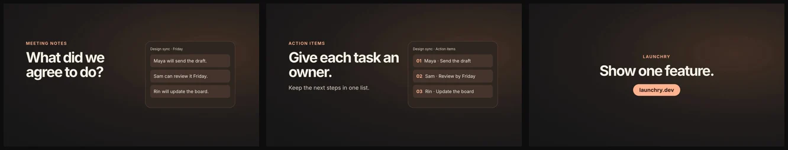
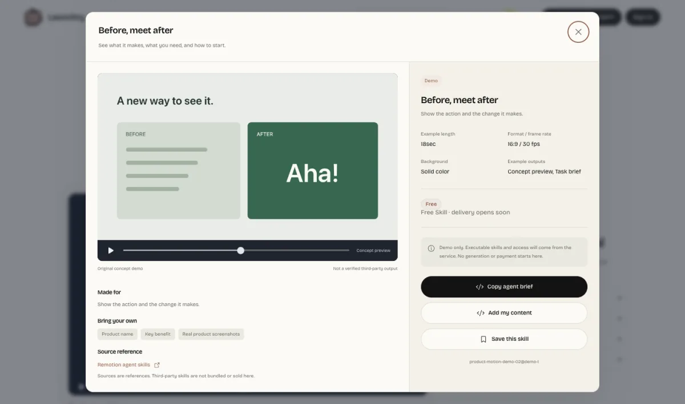
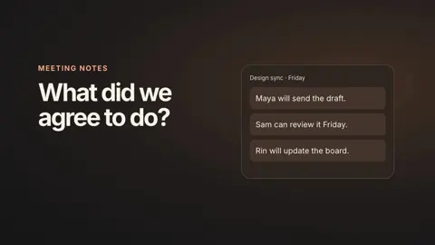

# Awesome GPT‑6.2 Sol Videos

A collection for videos made with **GPT‑6.2 Sol**, with creator credits, prompts and editable source where available. Pick a clip and try making your own with HTML, Canvas, SVG, Three.js or a video framework.

**Prelaunch.** The first entry is a HyperFrames starter demo. The GPT‑6.2 Sol collection opens after an [official OpenAI release](https://developers.openai.com/api/docs/models).

**[▶ Explore product launch videos and try a free demo on Launchry](https://launchry.dev/?resource=product-motion-demo-02&lang=en&utm_source=github&utm_medium=readme&utm_campaign=awesome-gpt-6-2-sol-videos&utm_content=featured_demo)**

- 1 starter video and 1 reusable prompt in [`prompts/`](prompts/) and [`data/videos.json`](data/videos.json)
- 1 free HyperFrames Skill with an editable HTML example
- Community entries link back to the creator’s original work

## Contents

- [Motion graphics](#motion-graphics)
- [Explainers](#explainers)
- [3D scenes](#3d-scenes)
- [Games & interactive](#games--interactive)
- [Latest prompts](#latest-prompts)
- [How to use a prompt](#how-to-use-a-prompt)
- [Free Skills](#free-skills)
- [Submit a video](#submit-a-video)
- [Credits](#credits)

## Motion graphics

<table>
  <tr>
    <td width="33%" valign="top">
       
      <a href="https://github.com/SnapSnap-LLC/awesome-gpt-6-2-sol-videos/releases/download/starter-v1/feature-reveal.mp4"><b>One Feature in 12 Seconds</b></a> 
      <a href="https://github.com/SnapSnap-LLC">SnapSnap‑LLC</a> · <a href="prompts/feature-reveal.md">Prompt</a> · <a href="examples/feature-reveal/index.html">HTML</a> 
      HyperFrames · Product demo · 12 sec · Starter example
    </td>
  </tr>
</table>

## Explainers

Open for submissions after the model release. Short visual explanations, tutorials and data stories fit here.

## 3D scenes

Open for submissions after the model release. Link the rendered clip and scene source when available.

## Games & interactive

Open for submissions after the model release. Link a playable build or recording.

## Latest prompts

| Prompt | Creator | Tools |
| --- | --- | --- |
| [One Feature in 12 Seconds](prompts/feature-reveal.md) | [SnapSnap‑LLC](https://github.com/SnapSnap-LLC) | HyperFrames |

## How to use a prompt

1. Copy the text under **Prompt** in an example file.
2. Give it to your coding agent with your own screenshots, recording or other assets.
3. Ask for the editable project and render it to MP4. The starter uses HyperFrames and includes the [source HTML](examples/feature-reveal/index.html).

## Free Skills

- **HyperFrames Launch Teaser.** Turn one feature into a 12-second video using a before-and-after shot and one call to action. [Download the Skill](https://github.com/SnapSnap-LLC/awesome-gpt-6-2-sol-videos/releases/download/starter-v1/hyperframes-launch-teaser.zip) · [Read the instructions](skills/hyperframes-launch-teaser/SKILL.md)
- **Remotion.** Build videos with React using the [official Remotion Skill](https://github.com/remotion-dev/skills/tree/main/skills/remotion-best-practices).

For Codex, unzip the download and copy the `hyperframes-launch-teaser/` folder into your project’s `.agents/skills/` directory. [Explore more video Skills on Launchry](https://launchry.dev/?lang=en&utm_source=github&utm_medium=readme&utm_campaign=awesome-gpt-6-2-sol-videos&utm_content=free_skills).

## Submit a video

[Open a submission](https://github.com/SnapSnap-LLC/awesome-gpt-6-2-sol-videos/issues/new?template=submit-video.yml) with the video, creator link and evidence of the model used. Include the public prompt or source if the creator shared it.

## Credits

The gallery format comes from [Awesome Opus 5.5 Videos](https://github.com/yihui-dev/awesome-opus5-5-videos). Its [HyperFrames example](https://github.com/yihui-dev/awesome-opus5-5-videos/blob/92aee2f586ac0715cb3cbcb6384834f98a33383d/prompts/ik-builds-585923.md) and [Remotion example](https://github.com/yihui-dev/awesome-opus5-5-videos/blob/92aee2f586ac0715cb3cbcb6384834f98a33383d/prompts/seantiffonnet-675262.md) inspired the free Skill choices. The bundled HyperFrames excerpt retains its [upstream attribution](NOTICE). Contributors retain rights to their own videos and prompts.
