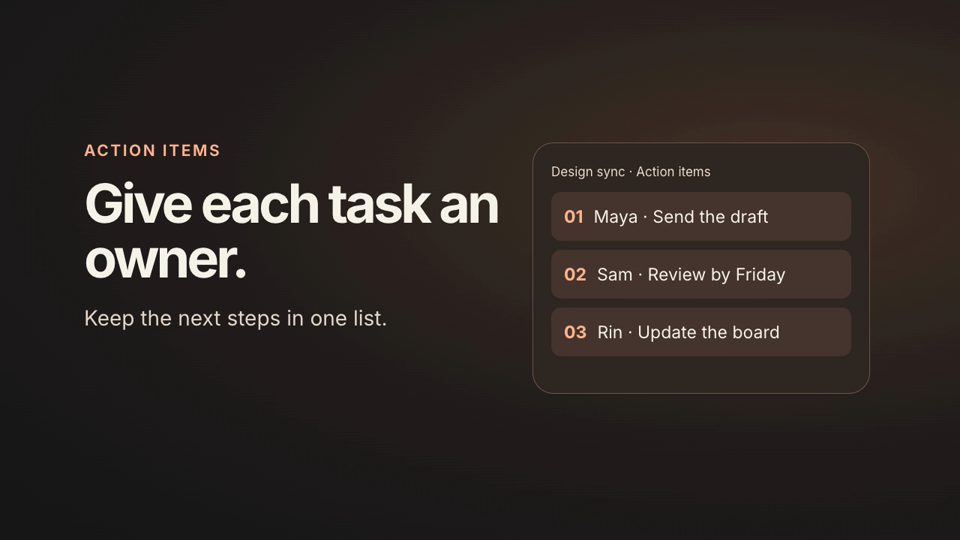

# Awesome GPT‑6.2 Sol Videos

A community video library in preparation for GPT‑6.2 Sol. Browse short videos made with code, see the prompts and tools behind them, and try a workflow with your own product.

**Prelaunch.** We’ll add videos to the model collection once OpenAI confirms the release and a creator identifies the model used. The starter below is a HyperFrames demo of the submission format. [OpenAI model list](https://developers.openai.com/api/docs/models)

## Watch a starter video

**One Feature in 12 Seconds** · HyperFrames · 16:9 · 12 sec · Fictional product example

[Watch MP4](https://github.com/SnapSnap-LLC/awesome-gpt-6-2-sol-videos/releases/download/starter-v1/feature-reveal.mp4) · [Copy the prompt](prompts/feature-reveal.md) · [View editable HTML](examples/feature-reveal/index.html)

## Try a free Skill

1. [Download the free Skill](https://github.com/SnapSnap-LLC/awesome-gpt-6-2-sol-videos/releases/download/starter-v1/hyperframes-launch-teaser.zip) or [read it on GitHub](skills/hyperframes-launch-teaser/SKILL.md). Unzip it and copy the `hyperframes-launch-teaser/` folder into your agent’s skills directory (for Codex, `.agents/skills/` in your project), or give your agent the Skill file and its references.
2. Share one real feature, one screenshot or recording, and the URL you want viewers to visit. Ask for a 12-second feature reveal.
3. [See a free feature demo on Launchry](https://launchry.dev/?resource=product-motion-demo-02&lang=en&utm_source=github&utm_medium=readme&utm_campaign=awesome-gpt-6-2-sol-videos&utm_content=free_skill) for another take on showing a feature. [Browse more product launch video Skills](https://launchry.dev/?lang=en&utm_source=github&utm_medium=readme&utm_campaign=awesome-gpt-6-2-sol-videos&utm_content=catalog).

Prefer React? Try the [official Remotion Skill](https://github.com/remotion-dev/skills/tree/main/skills/remotion-best-practices).

## Community videos

The model collection opens after the official release. It will cover product launches and feature demos, motion graphics, explainers, and 3D or interactive work.

[Submit a video](https://github.com/SnapSnap-LLC/awesome-gpt-6-2-sol-videos/issues/new?template=submit-video.yml) with a creator link, a public video link, and evidence of the model used. Add a prompt and editable source if the creator has shared them. The machine-readable index is in [data/videos.json](data/videos.json).

## Credits

The catalog format was inspired by [Awesome Opus 5.5 Videos](https://github.com/yihui-dev/awesome-opus5-5-videos). See how the engines appeared there in [@ik_builds’ HyperFrames example](https://github.com/yihui-dev/awesome-opus5-5-videos/blob/92aee2f586ac0715cb3cbcb6384834f98a33383d/prompts/ik-builds-585923.md) and [@SeanTiffonnet’s Remotion example](https://github.com/yihui-dev/awesome-opus5-5-videos/blob/92aee2f586ac0715cb3cbcb6384834f98a33383d/prompts/seantiffonnet-675262.md). The bundled HyperFrames excerpt retains its [upstream attribution](NOTICE). Contributors retain rights to their own videos and prompts.
